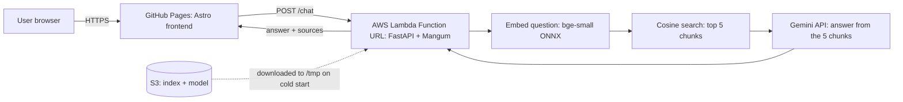
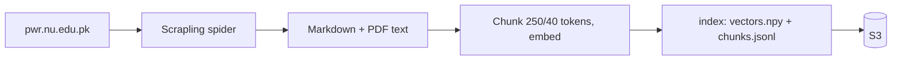

# FAST-NUCES Peshawar campus assistant

A retrieval-augmented chatbot that answers questions about the FAST-NUCES Peshawar campus (fees, admissions, hostels, calendar, faculty) using only text scraped from [pwr.nu.edu.pk](https://pwr.nu.edu.pk). It cites the pages it used.

- **Chat:** https://junaid-2k3.github.io/Rag-chatbot/
- **Backend health check:** https://nsgcu3ywayyk3gagfwq6thvkru0htuyi.lambda-url.ap-southeast-2.on.aws/health
- **Evaluation report:** [evaluation/report.md](evaluation/report.md) · **Build log:** [PROGRESS.md](PROGRESS.md)

## How it works



Built once, offline (not on AWS):



**One question, step by step**
1. The browser sends the question and the last 4 turns of history to `POST /chat`.
2. If there is history, Gemini first rewrites a follow-up ("and the fee?") into a standalone search query.
3. The query is embedded with `BAAI/bge-small-en-v1.5` (ONNX, CPU) and compared with every chunk vector (NumPy dot product). The top 5 chunks are kept.
4. If the best score is below 0.60, the bot refuses without calling Gemini.
5. Otherwise Gemini answers from those 5 chunks only, citing `[n]`. If they do not contain the answer it must reply `NOT_FOUND`.
6. Citations are renumbered to one number per distinct source page, and the page shows the answer plus source cards.

"Only" is enforced by the prompt, not by code. See [Known limitations](#known-limitations).

## Tech stack

The RAG pipeline is plain Python. There is no LangChain: each step is small enough to read, test and debug directly.

| Part | Tools |
|---|---|
| Scraping | Scrapling `Spider`, `markdownify` (HTML to Markdown), PyMuPDF (PDF text) |
| Retrieval | `BAAI/bge-small-en-v1.5` via ONNX Runtime + `tokenizers`; NumPy cosine similarity over `vectors.npy` (no vector database); custom heading-aware chunking, 250 tokens with 40 overlap |
| Generation | Gemini `gemini-3.1-flash-lite` with a fallback model, plain REST via `httpx`, no SDK; hand-written prompt builder, query rewriting, citation renumbering and refusal logic in `backend/app/services/` |
| Backend | FastAPI, pydantic, Mangum (Lambda adapter), pytest |
| Frontend | Astro 7 (Vite), TypeScript, plain CSS, self-hosted IBM Plex Sans; no UI framework or animation library |
| Infrastructure | AWS Lambda + Function URL, private S3 bucket, CloudWatch Logs, one CloudFormation template and a shell script; GitHub Pages + Actions for the frontend; Python 3.12 via `uv` |

## Repository layout

```
crawler/         spider.py (crawl), process.py (HTML/PDF -> Markdown)
data/            markdown/ (scraped pages), curated/ (hand-written facts), raw/ (not in git),
                 chunks.jsonl (old word-based chunks from the scraper; the chatbot does not use it)
ingestion/       build_index.py (chunk + embed -> index/), try_queries.py
index/           vectors.npy, chunks.jsonl, manifest.json (what the chatbot searches)
backend/         app/ (FastAPI, services/), lambda_handler.py, tests/
frontend/        Astro site (components, services/api.ts, lib/render.ts)
evaluation/      questions.jsonl, ground_truth.jsonl, evaluate.py, report.md
infrastructure/  template.yaml, build_zip.sh, deploy.sh, destroy.sh
.github/         workflows/deploy-frontend.yml
```

## Run it locally

Needs Python 3.12 (`uv`), Node 22+ with `pnpm`, and a Gemini API key.

```bash
uv venv --python 3.12 .venv
uv pip install --python .venv/bin/python -r backend/requirements.txt pytest
echo "GEMINI_API_KEY=your_key" > .env

# embedding model (127 MB, not in git)
.venv/bin/python -c "from huggingface_hub import snapshot_download as d; d('BAAI/bge-small-en-v1.5', allow_patterns=['onnx/model.onnx','tokenizer.json'], local_dir='models/bge-small')"

.venv/bin/python backend/cli.py                                          # terminal chat
.venv/bin/python -m uvicorn app.main:app --app-dir backend --port 8000   # API, docs at /docs
cd frontend && pnpm install && pnpm dev                                  # UI at http://localhost:4321
```

Tests: `.venv/bin/python -m pytest backend/tests` (23) and `cd frontend && pnpm test` (5).

## Rebuild the data

```bash
python3 -I crawler/spider.py                               # crawl -> data/raw, data/index.jsonl (resumable via crawl_state/)
python3 -I crawler/process.py                              # -> data/markdown/*.md
.venv/bin/python ingestion/build_index.py                  # chunk + embed -> index/ (about 7 minutes on CPU)
.venv/bin/python evaluation/evaluate.py --retrieval-only   # check retrieval before deploying
```

Outdated PDFs (2020 prospectus and handbook, 2021-22 calendars, timetables) are excluded in `ingestion/build_index.py`.

**Add a fact the pages do not state clearly:** put a Markdown file in `data/curated/` with the same header as `data/markdown/*.md` (`url`, `title`, `category`, `campus`, `source_type`), plain text below, and a `url` that points to a real page supporting the fact. Then rebuild the index and deploy.

## Deploy

Backend (AWS, region `ap-southeast-2`): needs the AWS CLI configured, `uv`, `zip`, and `GEMINI_API_KEY` in `.env`.

```bash
ALLOWED_ORIGINS=https://junaid-2k3.github.io ./infrastructure/deploy.sh
```

It creates a private S3 bucket, uploads the index, the embedding model and the code zip, and creates or updates the CloudFormation stack `fast-pwr-chatbot` (Lambda 1024 MB, 90 s timeout, reserved concurrency 3, 14-day logs). It prints the Function URL. `./infrastructure/destroy.sh` removes everything.

Frontend: push to `main`. The workflow builds and publishes to GitHub Pages; set the repository variable `PUBLIC_API_URL` to the Function URL. After changing the variable, run `gh workflow run deploy-frontend.yml` to rebuild.

Logs: `aws logs tail /aws/lambda/fast-pwr-chatbot --since 1h --region ap-southeast-2`. Logs record counts, model names and timings, never the question text.

New-style AWS Free plan accounts are locked to one region chosen from the contact country (Pakistan maps to `ap-southeast-2`); other regions are denied by AWS-managed policies. Do not set a "spend limit" in AWS Settings: near the limit AWS denies Lambda and CloudFormation creation.

## Evaluation

32 questions written from the corpus: 26 that the data can answer and 6 that must be refused. Relevance is page-level. Details and caveats: [evaluation/report.md](evaluation/report.md).

| Index | Chunks | Answerable questions | Recall@5 | Precision@5 | MRR |
|---|---|---|---|---|---|
| First version (450/80 tokens, raw text) | 1307 | 25 | 0.80 | 0.45 | 0.70 |
| Shipped 2026-11-12 | 1392 | 26 | 0.88 | 0.48 | 0.80 |
| **Current** | 1178 | 26 | **0.96** | **0.52** | **0.87** |

Answer level (Gemini answers, Gemini as judge): correct refusals 6/6, false refusals 0/26, faithfulness 5.0/5, relevancy 5.0/5. The judge is the same model family as the answerer, so faithfulness is an upper bound. The set is small, so one question moves Recall@5 by about 4 points. One question (the director) was added after a user reported a failure, so it measures the fix, not general ability.

What moved the numbers: stripping page boilerplate, smaller chunks (250 vs 450 tokens), and leaving the generic page title "FAST - NUCES Peshawar" out of the embedded text. That title had been prepended to every chunk, so queries containing "FAST NUCES Peshawar" matched the prefix instead of the content.

## Performance

Measured from Pakistan against the live backend in Sydney (a few dozen requests, not a benchmark):

| | Time |
|---|---|
| Network (connect + TLS) | about 0.7 s |
| Cold start | about 1.5 s init, plus about 2.5 s on the first request to download and load the model and index |
| Retrieval inside Lambda | milliseconds; the Gemini call dominates |
| Gemini `gemini-3.1-flash-lite` | median 1.3 s; occasional spikes of 6-14 s and rare 503s |
| End to end, typical | 2-6 s; first question after idle 5-10 s |

The fallback model `gemini-3.5-flash-lite` had a median of 8.5 s in the same test, so it is used only after the primary fails twice. Each Gemini attempt times out after 15 s. Lambda peak memory is about 540 MB of the 1024 MB configured.

## Limits and security

- Public endpoint, no login. Abuse limits: at most 3 concurrent Lambda executions, questions of 1-500 characters, 8 history messages of at most 2,000 characters. There is no per-IP rate limit.
- CORS allows only `https://junaid-2k3.github.io`. Swagger and OpenAPI are off in production.
- The Gemini key is a Lambda environment variable: anyone with access to this AWS account's console can read it. It is never in the frontend or in git.
- The S3 bucket is private; the Lambda role can only read `index/*` and `models/*`.
- Questions are sent to Google's Gemini API. Free-tier data handling may allow Google to use prompts, so do not type personal information.

## Design decisions

- **No vector database:** 1,178 chunks is 1.8 MB of vectors, so NumPy is simpler than a database and the index is just a file in S3. This does not scale to millions of chunks.
- **Zip + model from S3, not a container image:** the model plus libraries exceed the 250 MB zip limit, but a container image needs ECR storage, which is not free. The model downloads to `/tmp` on cold start instead.
- **Region:** forced by the account type, see Deploy.
- **Gemini over REST, no SDK:** keeps the Lambda package small.
- **Curated fact pages:** a way to fix one wrong answer without re-scraping.
- **Refusal cutoff 0.60:** it only stops the weakest off-topic queries. Answerable scores (minimum 0.68) and unanswerable ones (maximum 0.73) overlap, so refusals mostly depend on the LLM.

## Known limitations

- **Grounding is a prompt rule, not a guarantee.** Gemini sees only the top 5 chunks and is told to answer only from them, but nothing in code stops it using general knowledge or citing the wrong passage. Conversation history is also sent to it. To check, ask something the data cannot answer ("Who founded FAST?").
- **Follow-up rewriting can drift:** "and the admission fee?" after a hostel question is rewritten to a hostel query and returns the Rs 3,000 applicant fee instead of Rs 30,000.
- **Retrieval misses:** "What is the campus address?" does not find the contact page.
- **Outdated site content is repeated as fact** (old news pages are indexed).
- **Gemini free tier:** latency spikes and occasional "busy" errors.
- **Evaluation is small** and was written by the person who built the system.

## Data and scraping notice

The index contains text scraped from pwr.nu.edu.pk, which is FAST-NUCES content. The site's `robots.txt` disallows generic crawlers; this crawl overrode that by the project owner's decision, identified itself with a descriptive User-Agent and used 4 concurrent requests with a 0.5 s delay. If you reuse this, get permission from the site owner first. This project is not affiliated with FAST-NUCES. Answers may be wrong or out of date, so check [nu.edu.pk](https://nu.edu.pk) for anything important.
